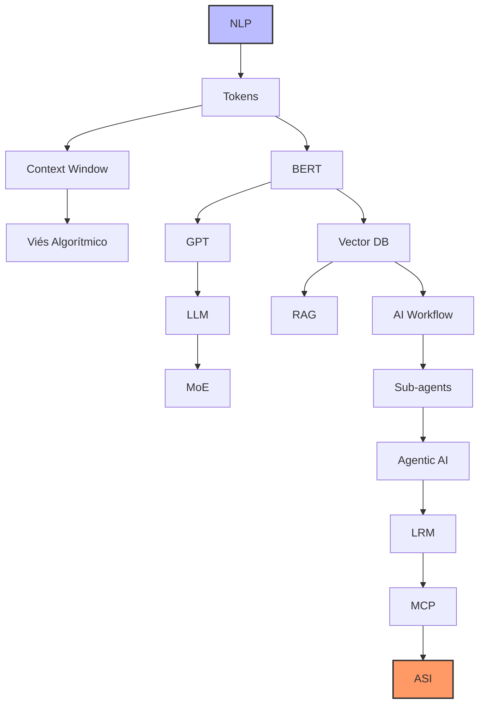

# Conceitos de IA

# 1. Resumo de conceitos

| Assunto | Surgimento (Aprox.) | Ordem de Estudo | Por que nesta ordem? |
| :--- | :--- | :--- | :--- |
| **NLP** | Anos 50/60 | **1** | A base teórica sobre como computadores processam linguagem humana. |
| **Tokens** | Anos 50/60 | **2** | A unidade fundamental. Sem entender tokens, você não entende custos nem limites. |
| **Viés Algorítmico** | Contínuo | **3** | Fundamental para entender as limitações e perigos dos dados desde o início. |
| **BERT** | 2018 | **4** | O marco inicial dos Transformers para compreensão de contexto bidirecional. |
| **GPT** | 2018 | **5** | O início da era generativa (foco em prever a próxima palavra). |
| **LLM** | 2020 | **6** | Quando os modelos ganharam escala e habilidades "emergentes". |
| **Context Window** | 2020 | **7** | Define quanto de informação o LLM consegue "manter na cabeça" por vez. |
| **MoE** | 2021 | **8** | Como modelos gigantes são eficientes usando apenas "partes" do cérebro. |
| **Vector Database** | 2021 | **9** | A infraestrutura necessária para dar memória de longo prazo aos modelos. |
| **RAG** | 2020/2023 | **10** | A técnica principal para conectar IAs a dados privados e atualizados. |
| **AI Workflow** | 2023 | **11** | Como estruturar processos que utilizam várias chamadas de IA em sequência. |
| **Agentic AI** | 2023/2024 | **12** | IAs que agem com autonomia para atingir um objetivo complexo. |
| **Sub-agents** | 2024 | **13** | A evolução da autonomia: agentes especializados gerenciados por um "chefe". |
| **LRM** | 2024 | **14** | Modelos que utilizam tempo de pensamento (Chain of Thought) para raciocínio lógico. |
| **MCP** | 2024 | **15** | O protocolo padrão mais recente para conectar agentes a qualquer base de dados. |
| **ASI** | Teórico | **16** | O horizonte final: quando a IA superar a inteligência humana em tudo. |

# 2. Planejamento de Estudos: Inteligência Artificial

## 2.1 Bloco A — Fundamentos Obrigatórios
*Sem estes, os demais temas ficam superficiais.*

1. **NLP (Natural Language Processing):** O campo da computação que estuda a interação entre máquinas e linguagem humana.
2. **Token:** A unidade básica de processamento dos modelos (pedaços de palavras ou caracteres).
3. **Context Window:** O limite de dados que o modelo consegue processar de uma só vez (sua "memória de curto prazo").
4. **Viés Algorítmico:** O estudo de como preconceitos nos dados de treino afetam os resultados da IA.

## 2.2. Bloco B — Modelos de Linguagem
*Entender como os modelos funcionam antes de usá-los como “caixa preta”.*

5. **BERT:** Modelo pioneiro do Google para entender o contexto bidirecional das frases.
6. **GPT:** Arquitetura focada em geração de texto (prever o próximo token).
7. **LLM (Large Language Model):** O conceito de modelos de linguagem em escala massiva.
8. **MoE (Mixture of Experts):** Técnica de arquitetura onde apenas "especialistas" internos do modelo são ativados, economizando processamento.

## 2.3.  Bloco C — Infraestrutura Semântica
*Essencial para aplicações reais, RAG e agentes.*

9. **Vector Database:** Bancos de dados que armazenam informações como coordenadas matemáticas (embeddings).
10. **RAG (Retrieval Augmented Generation):** Técnica que permite à IA consultar documentos externos antes de responder.

## 2.4.  Bloco D — Arquiteturas Modernas
*Aqui começa o “estado da arte”.*

11. **AI Workflow:** A estruturação de processos onde várias etapas de IA são encadeadas.
12. **Sub-agents:** Pequenas instâncias de IA especializadas em tarefas únicas.
13. **Agentic AI:** Sistemas com autonomia para planejar e executar ações para atingir um objetivo.
14. **LRM (Large Reasoning Model):** Modelos que "pensam" (Chain of Thought) antes de gerar a resposta final.
15. **MCP (Model Context Protocol):** O novo padrão para conectar modelos a fontes de dados e ferramentas de forma universal.

## 2.5.  Bloco E — Visão de Longo Prazo (Conceitual)
*Não é pré-requisito técnico, mas importante estrategicamente.*

16. **ASI (Artificial Super Intelligence):** O estágio hipotético em que a IA supera a inteligência humana em todos os domínios.

# 3. Diagrama

# 4. Conceitos por bloco

## 4.1. Bloco A — Fundamentos Obrigatórios

1. NLP (Natural Language Processing) É a subárea da Inteligência Artificial que combina linguística computacional e ciência de dados para permitir que softwares entendam, interpretem e gerem linguagem humana de forma natural. O objetivo do NLP é transpor a barreira entre a comunicação humana (que é ambígua, cheia de gírias e nuances) e o processamento de dados binários, sendo a base para tecnologias como tradutores automáticos, análise de sentimento e assistentes de voz.
   
2. Token Diferente dos humanos que leem palavras inteiras, os modelos de IA fragmentam o texto em unidades menores chamadas tokens, que podem ser palavras completas, sílabas ou até caracteres isolados. Esse processo de "tokenização" é crucial porque transforma a linguagem em sequências numéricas que a rede neural consegue processar matematicamente; em média, 1.000 tokens correspondem a cerca de 750 palavras em inglês.

3. Context Window (Janela de Contexto) Representa a capacidade máxima de dados (em tokens) que um modelo consegue "enxergar" e manter em sua memória de trabalho durante uma única interação. Se você fornecer um documento que exceda essa janela, a IA começará a "esquecer" o início do texto, perdendo a coesão. É o equivalente à quantidade de páginas que você consegue manter abertas na sua frente para realizar uma tarefa sem precisar fechar nenhuma.

4. Viés Algorítmico Ocorre quando um sistema de IA produz resultados sistematicamente distorcidos ou injustos, geralmente refletindo preconceitos históricos, sociais ou erros de amostragem presentes nos dados usados para treiná-lo. Como a IA aprende por padrões, se os dados de treino contiverem estereótipos de gênero, raça ou classe, o modelo irá replicar e até amplificar essas injustiças em suas previsões ou decisões automáticas.

5. A temperatura é um hiperparâmetro que regula o grau de aleatoriedade e criatividade nas respostas de um modelo de linguagem. Tecnicamente, ela ajusta as probabilidades dos tokens na camada de saída: uma temperatura baixa (próxima de 0) torna o modelo determinístico e focado na resposta mais provável, ideal para tarefas técnicas ou fatos; já uma temperatura alta (próxima de 1 ou mais) distribui a probabilidade entre outros tokens menos óbvios, resultando em textos mais variados, criativos e "ousados", porém com maior risco de inconsistência.

6. A alucinação ocorre quando um modelo de IA gera informações que soam convincentes e gramaticalmente corretas, mas que são factualmente falsas, inexistentes ou sem fundamento nos dados de entrada. Como os LLMs funcionam com base em probabilidades estatísticas para prever a próxima palavra — e não em um banco de dados de verdades absolutas —, eles podem acabar "inventando" referências bibliográficas, datas históricas ou funções de código quando tentam satisfazer o pedido do usuário sem ter a informação precisa em seus pesos de treinamento.

## 4.2. Bloco B — Modelos de Linguagem

7. BERT (Bidirectional Encoder Representations from Transformers) Lançado pelo Google em 2018, o BERT revolucionou o campo ao introduzir o processamento bidirecional. Diferente de modelos anteriores que liam o texto da esquerda para a direita ou vice-versa, o BERT analisa a frase inteira simultaneamente, permitindo que ele entenda o significado de uma palavra com base em tudo o que vem antes e depois dela. Essa capacidade o tornou excepcionalmente bom em tarefas de compreensão, como busca semântica e classificação de textos.

8. GPT (Generative Pre-trained Transformer) Desenvolvida pela OpenAI, a arquitetura GPT foca na capacidade generativa, utilizando um processamento unidirecional (causal). O seu princípio fundamental é a previsão do próximo token: dado um trecho de texto, o modelo calcula a probabilidade estatística da próxima unidade de informação. Ao ser treinado em volumes massivos de dados, essa simples tarefa de "completar frases" permite que o modelo desenvolva habilidades complexas de escrita, tradução e até programação.

9. LLM (Large Language Model) O termo refere-se a modelos de IA que atingiram uma escala massiva tanto em número de parâmetros (os "neurônios" virtuais) quanto em volume de dados de treinamento. O que define um LLM não é apenas o seu tamanho, mas o surgimento de "propriedades emergentes" — capacidades que não foram explicitamente programadas, como raciocínio lógico e resolução de problemas complexos, que só aparecem quando o modelo cruza um certo limiar de escala computacional.

10. MoE (Mixture of Experts) É uma técnica de design de redes neurais que permite criar modelos gigantescos de forma eficiente. Em vez de ativar todos os parâmetros para cada pergunta (como uma "caixa única"), o modelo é dividido em vários subconjuntos especializados (os "especialistas"). Quando uma tarefa chega, um roteador inteligente ativa apenas os especialistas mais relevantes para aquele assunto. Isso permite que modelos como o GPT-4 ou o Mixtral tenham trilhões de parâmetros, mas consumam menos energia e tempo de resposta do que se fossem modelos densos tradicionais.

## 4.3.  Bloco C — Infraestrutura Semântica

11. Vector Database (Banco de Dados Vetoriais) Diferente dos bancos de dados tradicionais que armazenam informações em tabelas ou textos simples, um banco de dados vetorial armazena dados como "embeddings" — sequências de números que representam as coordenadas de um conceito em um espaço multidimensional. Essa estrutura permite que o sistema realize buscas semânticas em vez de buscas por palavras-chave; ou seja, ele consegue encontrar informações relacionadas pelo significado. Por exemplo, se você buscar por "felino", ele será capaz de recuperar documentos sobre "gatos" mesmo que a palavra exata não esteja lá, por estarem geometricamente próximos no espaço vetorial.

12. RAG (Retrieval Augmented Generation) O RAG é uma arquitetura que otimiza a saída de um LLM consultando uma base de conhecimento confiável antes de gerar uma resposta. Em vez de confiar apenas no que a IA aprendeu durante seu treinamento (que pode estar defasado ou incompleto), o sistema primeiro "busca" (Retrieval) documentos relevantes em um banco de dados vetorial e, em seguida, entrega esse conteúdo como contexto para que a IA "gere" (Generation) a resposta. Isso reduz drasticamente as alucinações e permite que a IA responda sobre dados privados ou eventos que aconteceram hoje, funcionando como uma prova de "consulta a livro aberto" para o modelo.

1. RAG como o "Antídoto" para a Alucinação
A alucinação ocorre porque o LLM tenta prever a próxima palavra com base apenas em estatística. Ao introduzir o RAG, você força o modelo a basear sua resposta em fatos recuperados do Vector Database.

Logística: O sistema diz ao modelo: "Responda apenas com base nestes documentos. Se a resposta não estiver neles, diga que não sabe". Isso muda o comportamento do modelo de "inventar para agradar" para "consultar para informar".

2. Otimização da Temperatura para Precisão
Em sistemas que utilizam o Bloco C, a Temperatura geralmente é ajustada para valores muito baixos (perto de 0).

Por que? Se você investiu infraestrutura para buscar o dado exato no Vector Database através do RAG, você não quer que o modelo seja "criativo" com esses fatos. Uma temperatura baixa garante que a IA transmita a informação recuperada de forma fiel e técnica, sem "enfeitar" os dados.

3. Alucinação de Recuperação (Um novo desafio)
No Bloco C, surge um novo tipo de erro: a IA pode alucinar não porque é criativa, mas porque o Vector Database entregou um documento irrelevante (ruído), e ela tentou forçar uma conexão entre esse documento e a pergunta.

Isso é chamado de "Faithfulness" (Fidelidade): o desafio de garantir que a IA não ignore o conteúdo do RAG para voltar a usar seus próprios pesos internos (o que causaria a alucinação clássica).

| Conceito | Papel no Bloco C |
| :--- | :--- |
| **Alucinação** | É o "inimigo" que o RAG foi projetado para combater. |
| **Temperatura** | É o "botão de controle" que deixamos no mínimo para garantir que o RAG seja seguido à risca. |
| **Vector DB** | É a "âncora de realidade" que impede o modelo de flutuar para longe dos fatos. |

## 4.4.  Bloco D — Arquiteturas Modernas

13. AI Workflow (Fluxo de Trabalho de IA) Diferente de uma conversa única com um chatbot, um workflow de IA é uma sequência estruturada e programada de etapas onde a saída de uma tarefa serve como entrada para a próxima. Imagine um processo industrial: primeiro uma IA resume um e-mail, depois outra extrai dados técnicos e, por fim, uma terceira gera um relatório. Essa abordagem permite que tarefas complexas sejam quebradas em partes menores e mais controláveis, aumentando drasticamente a precisão e a confiabilidade do sistema final.

14. Sub-agents (Subagentes) São instâncias especializadas de IA projetadas para realizar uma única tarefa específica sob o comando de um "agente principal" ou coordenador. Em uma arquitetura de múltiplos agentes, os subagentes funcionam como departamentos de uma empresa: enquanto um subagente é especialista em pesquisar na web, outro é especialista em escrever código e um terceiro em revisar gramática. Essa divisão de trabalho evita que o modelo principal fique sobrecarregado e cometa erros por tentar fazer muitas coisas diferentes ao mesmo tempo.

15. Agentic AI (IA Agêntica) Representa a evolução da IA para sistemas que possuem um grau de autonomia para planejar e executar ações. Ao receber um objetivo (ex: "Organize minha viagem de férias dentro do meu orçamento"), uma IA agêntica não apenas sugere destinos, mas decide quais ferramentas usar, acessa sites de busca, compara preços, resolve imprevistos e completa a tarefa com o mínimo de intervenção humana. Ela não espera por comandos passo a passo; ela entende o objetivo final e traça o próprio caminho para chegar lá.

16. LRM (Large Reasoning Model - Modelo de Raciocínio) Enquanto os LLMs tradicionais são focados em fluência e predição rápida de palavras, os LRMs são treinados especificamente para "pensar antes de falar" através de uma técnica chamada Chain of Thought (Cadeia de Pensamento). Esses modelos utilizam tempo de processamento extra para verificar logicamente diferentes caminhos de solução, corrigir os próprios erros de raciocínio e validar hipóteses antes de entregar a resposta final, sendo ideais para matemática avançada, lógica jurídica e programação complexa.

17. MCP (Model Context Protocol) Lançado pela Anthropic no final de 2024, o MCP é um padrão aberto que resolve o problema da "comunicação" entre IAs e o mundo exterior. Ele funciona como uma "porta universal" (similar ao que o USB fez para o hardware) que permite que qualquer modelo de IA se conecte instantaneamente a bancos de dados, ferramentas de software (como Google Drive, Slack ou GitHub) e sistemas locais sem a necessidade de criar uma integração personalizada para cada uma. É a infraestrutura técnica que finalmente permite que agentes acessem seus dados de forma segura e padronizada.

## 4.5.  Bloco E — Visão de Longo Prazo (Conceitual)

18. ASI (Artificial Super Intelligence - Superinteligência Artificial) A ASI é um estágio teórico da evolução da IA em que o sistema não apenas iguala a inteligência humana (o chamado AGI), mas a supera vastamente em todas as áreas, incluindo criatividade científica, sabedoria social e habilidades de resolução de problemas. Diferente dos modelos atuais, uma ASI seria capaz de processar informações em velocidades impossíveis para o cérebro biológico e realizar descobertas que a humanidade levaria séculos para alcançar. É um conceito que levanta debates profundos sobre o "alinhamento" (garantir que os objetivos da IA sejam os mesmos dos humanos) e é considerado o ponto de singularidade tecnológica, onde o progresso se torna exponencial e imprevisível.

# 5. Resumo

* Bloco A & B: O motor e o combustível (NLP, Tokens, LLMs).

* Bloco C & D: O corpo e a ação (RAG, Fluxos, Agentes, MCP).

* Bloco E: O horizonte (ASI).

# 6. 