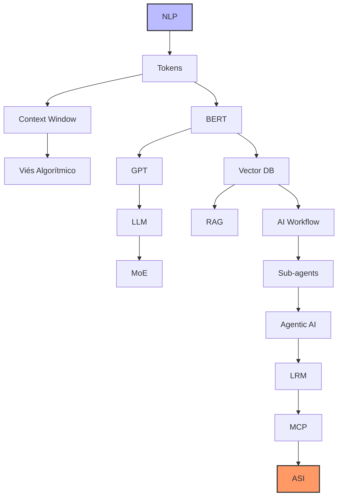
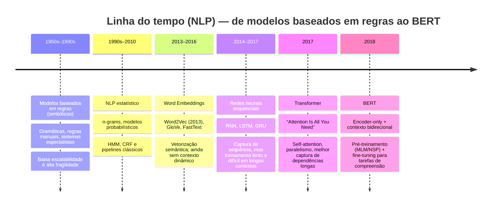
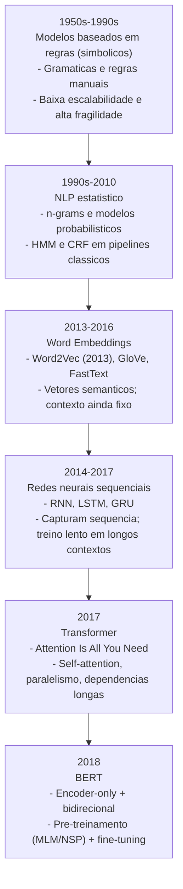
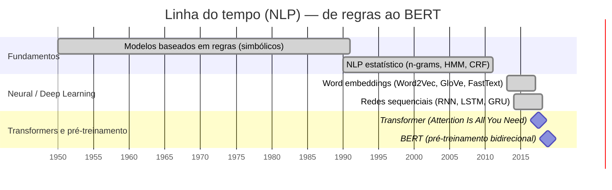
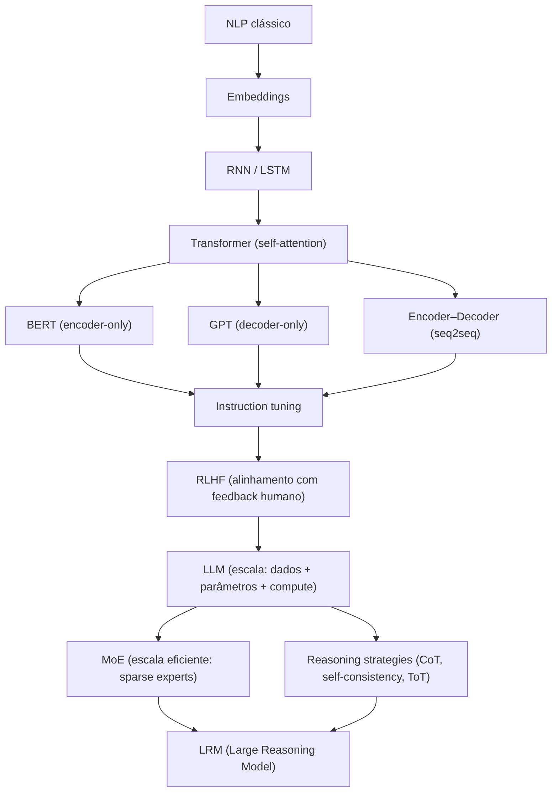
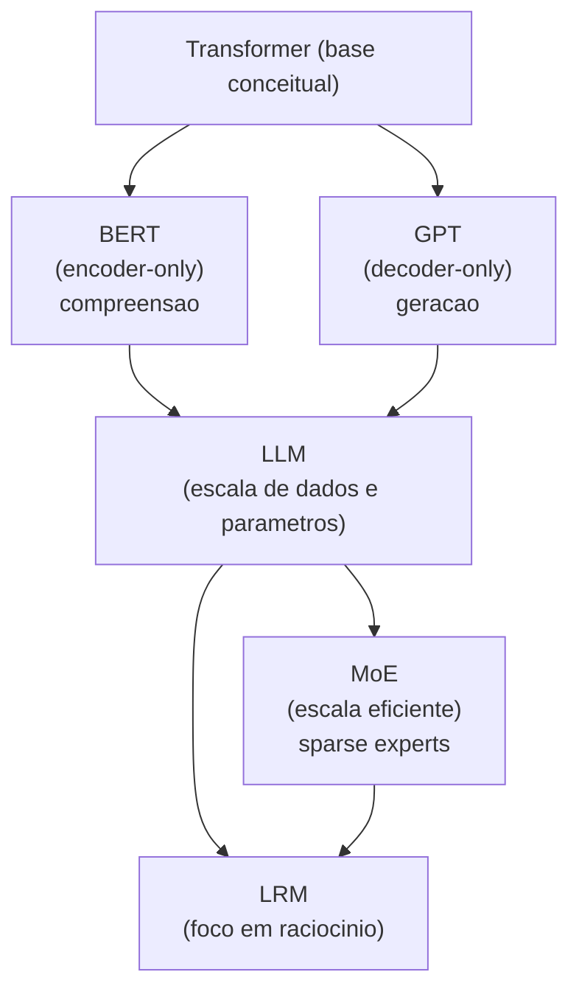
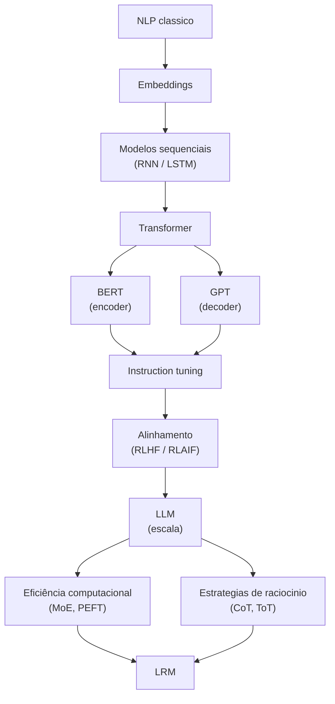

# Conceitos de IA

- [Conceitos de IA](#conceitos-de-ia)
- [1. Resumo de conceitos](#1-resumo-de-conceitos)
- [2. Planejamento de Estudos: Inteligência Artificial](#2-planejamento-de-estudos-inteligência-artificial)
  - [2.1 Bloco A — Fundamentos Obrigatórios](#21-bloco-a--fundamentos-obrigatórios)
  - [2.2. Bloco B — Modelos de Linguagem](#22-bloco-b--modelos-de-linguagem)
  - [2.3.  Bloco C — Infraestrutura Semântica](#23--bloco-c--infraestrutura-semântica)
  - [2.4.  Bloco D — Arquiteturas Modernas](#24--bloco-d--arquiteturas-modernas)
  - [2.5.  Bloco E — Visão de Longo Prazo (Conceitual)](#25--bloco-e--visão-de-longo-prazo-conceitual)
- [3. Diagrama](#3-diagrama)
- [4. Conceitos por bloco](#4-conceitos-por-bloco)
  - [4.1. Bloco A — Fundamentos Obrigatórios](#41-bloco-a--fundamentos-obrigatórios)
  - [4.2. Bloco B — Modelos de Linguagem](#42-bloco-b--modelos-de-linguagem)
  - [4.3.  Bloco C — Infraestrutura Semântica](#43--bloco-c--infraestrutura-semântica)
  - [4.4.  Bloco D — Arquiteturas Modernas](#44--bloco-d--arquiteturas-modernas)
  - [4.5.  Bloco E — Visão de Longo Prazo (Conceitual)](#45--bloco-e--visão-de-longo-prazo-conceitual)
- [5. Resumo](#5-resumo)
- [6. Detalhamento](#6-detalhamento)
  - [6.1. NLP](#61-nlp)
    - [1. A Anatomia do Texto (Linguística Computacional)](#1-a-anatomia-do-texto-linguística-computacional)
    - [2. A Ponte para a Matemática (Vetorização)](#2-a-ponte-para-a-matemática-vetorização)
    - [3. Tarefas Clássicas de NLP](#3-tarefas-clássicas-de-nlp)
  - [6.2. Tokenização](#62-tokenização)
  - [6.3. Context window](#63-context-window)
  - [6.4. Viés algoritmico](#64-viés-algoritmico)
  - [6.5. Do BERT ao GPT](#65-do-bert-ao-gpt)
    - [6.5.1. Outros conceitos técnicos](#651-outros-conceitos-técnicos)
    - [6.5.2. Gráfico relacionando BERT, GPT, LLM, MoE e LRM](#652-gráfico-relacionando-bert-gpt-llm-moe-e-lrm)
    - [6.5.3. Mapa de dependência conceitual](#653-mapa-de-dependência-conceitual)
  - [6.6. Vector Database (Banco de Dados Vetorial)](#66-vector-database-banco-de-dados-vetorial)
  - [6.7. RAG (Retrieval-Augmented Generation)](#67-rag-retrieval-augmented-generation)


# 1. Resumo de conceitos

| Assunto | Surgimento (Aprox.) | Ordem de Estudo | Por que nesta ordem? |
| :--- | :--- | :--- | :--- |
| **NLP** | Anos 50/60 | **1** | A base teórica sobre como computadores processam linguagem humana. |
| **Tokens** | Anos 50/60 | **2** | A unidade fundamental. Sem entender tokens, você não entende custos nem limites. |
| **Viés Algorítmico** | Contínuo | **3** | Fundamental para entender as limitações e perigos dos dados desde o início. |
| **BERT** | 2018 | **4** | O marco inicial dos Transformers para compreensão de contexto bidirecional. |
| **GPT** | 2018 | **5** | O início da era generativa (foco em prever a próxima palavra). |
| **LLM** | 2020 | **6** | Quando os modelos ganharam escala e habilidades "emergentes". |
| **Context Window** | 2020 | **7** | Define quanto de informação o LLM consegue "manter na cabeça" por vez. |
| **MoE** | 2021 | **8** | Como modelos gigantes são eficientes usando apenas "partes" do cérebro. |
| **Vector Database** | 2021 | **9** | A infraestrutura necessária para dar memória de longo prazo aos modelos. |
| **RAG** | 2020/2023 | **10** | A técnica principal para conectar IAs a dados privados e atualizados. |
| **AI Workflow** | 2023 | **11** | Como estruturar processos que utilizam várias chamadas de IA em sequência. |
| **Agentic AI** | 2023/2024 | **12** | IAs que agem com autonomia para atingir um objetivo complexo. |
| **Sub-agents** | 2024 | **13** | A evolução da autonomia: agentes especializados gerenciados por um "chefe". |
| **LRM** | 2024 | **14** | Modelos que utilizam tempo de pensamento (Chain of Thought) para raciocínio lógico. |
| **MCP** | 2024 | **15** | O protocolo padrão mais recente para conectar agentes a qualquer base de dados. |
| **ASI** | Teórico | **16** | O horizonte final: quando a IA superar a inteligência humana em tudo. |

# 2. Planejamento de Estudos: Inteligência Artificial

## 2.1 Bloco A — Fundamentos Obrigatórios
*Sem estes, os demais temas ficam superficiais.*

1. **NLP (Natural Language Processing):** O campo da computação que estuda a interação entre máquinas e linguagem humana.
2. **Token:** A unidade básica de processamento dos modelos (pedaços de palavras ou caracteres).
3. **Context Window:** O limite de dados que o modelo consegue processar de uma só vez (sua "memória de curto prazo").
4. **Viés Algorítmico:** O estudo de como preconceitos nos dados de treino afetam os resultados da IA.

## 2.2. Bloco B — Modelos de Linguagem
*Entender como os modelos funcionam antes de usá-los como “caixa preta”.*

5. **BERT:** Modelo pioneiro do Google para entender o contexto bidirecional das frases.
6. **GPT:** Arquitetura focada em geração de texto (prever o próximo token).
7. **LLM (Large Language Model):** O conceito de modelos de linguagem em escala massiva.
8. **MoE (Mixture of Experts):** Técnica de arquitetura onde apenas "especialistas" internos do modelo são ativados, economizando processamento.

## 2.3.  Bloco C — Infraestrutura Semântica
*Essencial para aplicações reais, RAG e agentes.*

9. **Vector Database:** Bancos de dados que armazenam informações como coordenadas matemáticas (embeddings).
10. **RAG (Retrieval Augmented Generation):** Técnica que permite à IA consultar documentos externos antes de responder.

## 2.4.  Bloco D — Arquiteturas Modernas
*Aqui começa o “estado da arte”.*

11. **AI Workflow:** A estruturação de processos onde várias etapas de IA são encadeadas.
12. **Sub-agents:** Pequenas instâncias de IA especializadas em tarefas únicas.
13. **Agentic AI:** Sistemas com autonomia para planejar e executar ações para atingir um objetivo.
14. **LRM (Large Reasoning Model):** Modelos que "pensam" (Chain of Thought) antes de gerar a resposta final.
15. **MCP (Model Context Protocol):** O novo padrão para conectar modelos a fontes de dados e ferramentas de forma universal.

## 2.5.  Bloco E — Visão de Longo Prazo (Conceitual)
*Não é pré-requisito técnico, mas importante estrategicamente.*

16. **ASI (Artificial Super Intelligence):** O estágio hipotético em que a IA supera a inteligência humana em todos os domínios.

# 3. Diagrama



# 4. Conceitos por bloco


## 4.1. Bloco A — Fundamentos Obrigatórios

1. NLP (Natural Language Processing) É a subárea da Inteligência Artificial que combina linguística computacional e ciência de dados para permitir que softwares entendam, interpretem e gerem linguagem humana de forma natural. O objetivo do NLP é transpor a barreira entre a comunicação humana (que é ambígua, cheia de gírias e nuances) e o processamento de dados binários, sendo a base para tecnologias como tradutores automáticos, análise de sentimento e assistentes de voz.
   
2. Token Diferente dos humanos que leem palavras inteiras, os modelos de IA fragmentam o texto em unidades menores chamadas tokens, que podem ser palavras completas, sílabas ou até caracteres isolados. Esse processo de "tokenização" é crucial porque transforma a linguagem em sequências numéricas que a rede neural consegue processar matematicamente; em média, 1.000 tokens correspondem a cerca de 750 palavras em inglês.

3. Context Window (Janela de Contexto) Representa a capacidade máxima de dados (em tokens) que um modelo consegue "enxergar" e manter em sua memória de trabalho durante uma única interação. Se você fornecer um documento que exceda essa janela, a IA começará a "esquecer" o início do texto, perdendo a coesão. É o equivalente à quantidade de páginas que você consegue manter abertas na sua frente para realizar uma tarefa sem precisar fechar nenhuma.

4. Viés Algorítmico Ocorre quando um sistema de IA produz resultados sistematicamente distorcidos ou injustos, geralmente refletindo preconceitos históricos, sociais ou erros de amostragem presentes nos dados usados para treiná-lo. Como a IA aprende por padrões, se os dados de treino contiverem estereótipos de gênero, raça ou classe, o modelo irá replicar e até amplificar essas injustiças em suas previsões ou decisões automáticas.

5. A temperatura é um hiperparâmetro que regula o grau de aleatoriedade e criatividade nas respostas de um modelo de linguagem. Tecnicamente, ela ajusta as probabilidades dos tokens na camada de saída: uma temperatura baixa (próxima de 0) torna o modelo determinístico e focado na resposta mais provável, ideal para tarefas técnicas ou fatos; já uma temperatura alta (próxima de 1 ou mais) distribui a probabilidade entre outros tokens menos óbvios, resultando em textos mais variados, criativos e "ousados", porém com maior risco de inconsistência.

6. A alucinação ocorre quando um modelo de IA gera informações que soam convincentes e gramaticalmente corretas, mas que são factualmente falsas, inexistentes ou sem fundamento nos dados de entrada. Como os LLMs funcionam com base em probabilidades estatísticas para prever a próxima palavra — e não em um banco de dados de verdades absolutas —, eles podem acabar "inventando" referências bibliográficas, datas históricas ou funções de código quando tentam satisfazer o pedido do usuário sem ter a informação precisa em seus pesos de treinamento.

## 4.2. Bloco B — Modelos de Linguagem

7. BERT (Bidirectional Encoder Representations from Transformers) Lançado pelo Google em 2018, o BERT revolucionou o campo ao introduzir o processamento bidirecional. Diferente de modelos anteriores que liam o texto da esquerda para a direita ou vice-versa, o BERT analisa a frase inteira simultaneamente, permitindo que ele entenda o significado de uma palavra com base em tudo o que vem antes e depois dela. Essa capacidade o tornou excepcionalmente bom em tarefas de compreensão, como busca semântica e classificação de textos.

8. GPT (Generative Pre-trained Transformer) Desenvolvida pela OpenAI, a arquitetura GPT foca na capacidade generativa, utilizando um processamento unidirecional (causal). O seu princípio fundamental é a previsão do próximo token: dado um trecho de texto, o modelo calcula a probabilidade estatística da próxima unidade de informação. Ao ser treinado em volumes massivos de dados, essa simples tarefa de "completar frases" permite que o modelo desenvolva habilidades complexas de escrita, tradução e até programação.

9. LLM (Large Language Model) O termo refere-se a modelos de IA que atingiram uma escala massiva tanto em número de parâmetros (os "neurônios" virtuais) quanto em volume de dados de treinamento. O que define um LLM não é apenas o seu tamanho, mas o surgimento de "propriedades emergentes" — capacidades que não foram explicitamente programadas, como raciocínio lógico e resolução de problemas complexos, que só aparecem quando o modelo cruza um certo limiar de escala computacional.

10. MoE (Mixture of Experts) É uma técnica de design de redes neurais que permite criar modelos gigantescos de forma eficiente. Em vez de ativar todos os parâmetros para cada pergunta (como uma "caixa única"), o modelo é dividido em vários subconjuntos especializados (os "especialistas"). Quando uma tarefa chega, um roteador inteligente ativa apenas os especialistas mais relevantes para aquele assunto. Isso permite que modelos como o GPT-4 ou o Mixtral tenham trilhões de parâmetros, mas consumam menos energia e tempo de resposta do que se fossem modelos densos tradicionais.

## 4.3.  Bloco C — Infraestrutura Semântica

11. Vector Database (Banco de Dados Vetoriais) Diferente dos bancos de dados tradicionais que armazenam informações em tabelas ou textos simples, um banco de dados vetorial armazena dados como "embeddings" — sequências de números que representam as coordenadas de um conceito em um espaço multidimensional. Essa estrutura permite que o sistema realize buscas semânticas em vez de buscas por palavras-chave; ou seja, ele consegue encontrar informações relacionadas pelo significado. Por exemplo, se você buscar por "felino", ele será capaz de recuperar documentos sobre "gatos" mesmo que a palavra exata não esteja lá, por estarem geometricamente próximos no espaço vetorial.

12. RAG (Retrieval Augmented Generation) O RAG é uma arquitetura que otimiza a saída de um LLM consultando uma base de conhecimento confiável antes de gerar uma resposta. Em vez de confiar apenas no que a IA aprendeu durante seu treinamento (que pode estar defasado ou incompleto), o sistema primeiro "busca" (Retrieval) documentos relevantes em um banco de dados vetorial e, em seguida, entrega esse conteúdo como contexto para que a IA "gere" (Generation) a resposta. Isso reduz drasticamente as alucinações e permite que a IA responda sobre dados privados ou eventos que aconteceram hoje, funcionando como uma prova de "consulta a livro aberto" para o modelo.


1. RAG como o "Antídoto" para a Alucinação
A alucinação ocorre porque o LLM tenta prever a próxima palavra com base apenas em estatística. Ao introduzir o RAG, você força o modelo a basear sua resposta em fatos recuperados do Vector Database.

Logística: O sistema diz ao modelo: "Responda apenas com base nestes documentos. Se a resposta não estiver neles, diga que não sabe". Isso muda o comportamento do modelo de "inventar para agradar" para "consultar para informar".

2. Otimização da Temperatura para Precisão
Em sistemas que utilizam o Bloco C, a Temperatura geralmente é ajustada para valores muito baixos (perto de 0).

Por que? Se você investiu infraestrutura para buscar o dado exato no Vector Database através do RAG, você não quer que o modelo seja "criativo" com esses fatos. Uma temperatura baixa garante que a IA transmita a informação recuperada de forma fiel e técnica, sem "enfeitar" os dados.

3. Alucinação de Recuperação (Um novo desafio)
No Bloco C, surge um novo tipo de erro: a IA pode alucinar não porque é criativa, mas porque o Vector Database entregou um documento irrelevante (ruído), e ela tentou forçar uma conexão entre esse documento e a pergunta.

Isso é chamado de "Faithfulness" (Fidelidade): o desafio de garantir que a IA não ignore o conteúdo do RAG para voltar a usar seus próprios pesos internos (o que causaria a alucinação clássica).

| Conceito | Papel no Bloco C |
| :--- | :--- |
| **Alucinação** | É o "inimigo" que o RAG foi projetado para combater. |
| **Temperatura** | É o "botão de controle" que deixamos no mínimo para garantir que o RAG seja seguido à risca. |
| **Vector DB** | É a "âncora de realidade" que impede o modelo de flutuar para longe dos fatos. |

## 4.4.  Bloco D — Arquiteturas Modernas

13. AI Workflow (Fluxo de Trabalho de IA) Diferente de uma conversa única com um chatbot, um workflow de IA é uma sequência estruturada e programada de etapas onde a saída de uma tarefa serve como entrada para a próxima. Imagine um processo industrial: primeiro uma IA resume um e-mail, depois outra extrai dados técnicos e, por fim, uma terceira gera um relatório. Essa abordagem permite que tarefas complexas sejam quebradas em partes menores e mais controláveis, aumentando drasticamente a precisão e a confiabilidade do sistema final.

14. Sub-agents (Subagentes) São instâncias especializadas de IA projetadas para realizar uma única tarefa específica sob o comando de um "agente principal" ou coordenador. Em uma arquitetura de múltiplos agentes, os subagentes funcionam como departamentos de uma empresa: enquanto um subagente é especialista em pesquisar na web, outro é especialista em escrever código e um terceiro em revisar gramática. Essa divisão de trabalho evita que o modelo principal fique sobrecarregado e cometa erros por tentar fazer muitas coisas diferentes ao mesmo tempo.

15. Agentic AI (IA Agêntica) Representa a evolução da IA para sistemas que possuem um grau de autonomia para planejar e executar ações. Ao receber um objetivo (ex: "Organize minha viagem de férias dentro do meu orçamento"), uma IA agêntica não apenas sugere destinos, mas decide quais ferramentas usar, acessa sites de busca, compara preços, resolve imprevistos e completa a tarefa com o mínimo de intervenção humana. Ela não espera por comandos passo a passo; ela entende o objetivo final e traça o próprio caminho para chegar lá.

16. LRM (Large Reasoning Model - Modelo de Raciocínio) Enquanto os LLMs tradicionais são focados em fluência e predição rápida de palavras, os LRMs são treinados especificamente para "pensar antes de falar" através de uma técnica chamada Chain of Thought (Cadeia de Pensamento). Esses modelos utilizam tempo de processamento extra para verificar logicamente diferentes caminhos de solução, corrigir os próprios erros de raciocínio e validar hipóteses antes de entregar a resposta final, sendo ideais para matemática avançada, lógica jurídica e programação complexa.

17. MCP (Model Context Protocol) Lançado pela Anthropic no final de 2024, o MCP é um padrão aberto que resolve o problema da "comunicação" entre IAs e o mundo exterior. Ele funciona como uma "porta universal" (similar ao que o USB fez para o hardware) que permite que qualquer modelo de IA se conecte instantaneamente a bancos de dados, ferramentas de software (como Google Drive, Slack ou GitHub) e sistemas locais sem a necessidade de criar uma integração personalizada para cada uma. É a infraestrutura técnica que finalmente permite que agentes acessem seus dados de forma segura e padronizada.

## 4.5.  Bloco E — Visão de Longo Prazo (Conceitual)

18. ASI (Artificial Super Intelligence - Superinteligência Artificial) A ASI é um estágio teórico da evolução da IA em que o sistema não apenas iguala a inteligência humana (o chamado AGI), mas a supera vastamente em todas as áreas, incluindo criatividade científica, sabedoria social e habilidades de resolução de problemas. Diferente dos modelos atuais, uma ASI seria capaz de processar informações em velocidades impossíveis para o cérebro biológico e realizar descobertas que a humanidade levaria séculos para alcançar. É um conceito que levanta debates profundos sobre o "alinhamento" (garantir que os objetivos da IA sejam os mesmos dos humanos) e é considerado o ponto de singularidade tecnológica, onde o progresso se torna exponencial e imprevisível.

# 5. Resumo

* Bloco A & B: O motor e o combustível (NLP, Tokens, LLMs).

* Bloco C & D: O corpo e a ação (RAG, Fluxos, Agentes, MCP).

* Bloco E: O horizonte (ASI).

# 6. Detalhamento

## 6.1. NLP

### 1. A Anatomia do Texto (Linguística Computacional)

Antes da IA "entender", ela precisa limpar o terreno. No NLP tradicional e moderno, usamos estes processos:

Normalization (Normalização): Transformar tudo para minúsculas, remover pontuações inúteis e padronizar o texto (ex: "Vô" e "Vovô" podem ser tratados de forma similar).

Stemming e Lemmatization: Reduzir palavras ao seu radical ou forma base.

Exemplo: "Correndo", "correu" e "corre" tornam-se apenas "corr-". Isso ajuda a IA a entender que a ação é a mesma.

Stop Words: Filtrar palavras que não carregam significado sozinhas (como "o", "a", "de", "com").

### 2. A Ponte para a Matemática (Vetorização)

Aqui está o segredo: Máquinas não processam palavras, elas processam números.

Bag of Words (BoW): A forma mais simples. Apenas conta quantas vezes cada palavra aparece em um texto.

TF-IDF: Uma técnica mais inteligente que dá peso às palavras. Se a palavra "clima" aparece muito em um texto de meteorologia, ela é importante. Se a palavra "o" aparece muito, ela é ignorada.

Word Embeddings: É o conceito mais moderno. Cada palavra vira uma coordenada em um espaço 3D (ou de mil dimensões).

Magia matemática: No mundo dos embeddings, se você fizer a conta Rei - Homem + Mulher, o resultado matemático será as coordenadas da palavra Rainha.

### 3. Tarefas Clássicas de NLP
    
Ao estudar, você verá que o NLP busca resolver problemas específicos:

Análise de Sentimento: Classificar se um texto é "positivo", "negativo" ou "neutro".

NER (Named Entity Recognition): Identificar o que é nome de pessoa, o que é empresa e o que é cidade dentro de um parágrafo.

Part-of-Speech Tagging: Identificar quem é o verbo, o substantivo e o adjetivo na frase.


O NLTK (Natural Language Toolkit) é a biblioteca mais tradicional e acadêmica, servindo como uma enorme caixa de ferramentas para quem está aprendendo os fundamentos do NLP, pois oferece centenas de algoritmos e conjuntos de dados para tarefas granulares como separação de frases e estudos linguísticos detalhados. Já o spaCy é focado em performance e ambiente de produção, servindo para processar grandes volumes de dados de forma extremamente rápida e industrial, entregando modelos de inteligência artificial já prontos para identificar nomes, entidades e estruturas gramaticais com mínima configuração. Enquanto o NLTK é excelente para exploração e ensino, o spaCy é a escolha padrão para construir aplicações reais que precisam de velocidade e precisão.

Exemplo com SpaCy

```python
import spacy

# 1. Carrega o modelo de IA para a língua portuguesa
nlp = spacy.load("pt_core_news_sm")

# 2. Texto de exemplo para processamento
texto = "O Google foi fundado por Larry Page nos Estados Unidos. Eles estão inovando em IA hoje."

# 3. O 'nlp' processa o texto (fazendo tokenização, análise gramatical e reconhecimento de entidades)
doc = nlp(texto)

print("--- ANALISE DE TOKENS ---")
# Demonstração de Tokens e Lemmatização (forma base da palavra)
for token in doc[:6]: # Analisando os primeiros 6 tokens
    print(f"Token: {token.text:10} | Raiz (Lemma): {token.lemma_:10} | Classe: {token.pos_}")

print("\n--- RECONHECIMENTO DE ENTIDADES (NER) ---")
# Identifica o que é Organização, Pessoa ou Local
for entidade in doc.ents:
    print(f"Entidade: {entidade.text:15} | Categoria: {entidade.label_}")
```

O que este código prova:
Tokenização: Ele quebra a frase automaticamente, sabendo que "fundado" e "por" são unidades distintas.

Inteligência Linguística: Ele entende que a raiz (lemma) de "estão" é o verbo "estar".

Contexto (NER): Ele identifica que "Google" é uma organização (ORG) e "Larry Page" é uma pessoa (PER), sem que você precise dizer isso a ele.

Exemplo com NLTK

```python
import nltk
from nltk.tokenize import word_tokenize
from nltk.corpus import stopwords
from nltk.stem import RSLPStemmer # Stemmer específico para Português

# 1. Baixa os recursos necessários (apenas na primeira vez)
nltk.download('punkt')
nltk.download('stopwords')
nltk.download('rslp')

# 2. Texto de exemplo
texto = "O sistema está processando as informações rapidamente."

# 3. Tokenização (quebrar em palavras)
tokens = word_tokenize(texto, language='portuguese')

# 4. Remoção de Stop Words (o, está, as...)
palavras_sem_sentido = set(stopwords.words('portuguese'))
tokens_filtrados = [w for w in tokens if w.lower() not in palavras_sem_sentido]

# 5. Stemming (reduzir ao radical)
stemmer = RSLPStemmer()
radicais = [stemmer.stem(w) for w in tokens_filtrados]

print(f"Texto original: {texto}")
print(f"Tokens filtrados: {tokens_filtrados}")
print(f"Radicais (Stemming): {radicais}")
```

O que este código demonstra de diferente:
Limpeza de Dados: Ele identifica que palavras como "O", "está" e "as" são ruídos para uma análise estatística e as remove.

Stemming (RSLP): Veja como "processando" vira process e "rapidamente" vira rapid. O NLTK é muito usado para essa "redução bruta", útil para criar buscadores simples onde "processamento" e "processado" devem ser encontrados pela mesma raiz.


| Característica | **NLTK** (Natural Language Toolkit) | **spaCy** |
| :--- | :--- | :--- |
| **Filosofia** | Acadêmica, modular e educacional. | Pragmática, industrial e eficiente. |
| **Facilidade de Uso** | Mais manual (você precisa configurar cada etapa). | Mais automática (entrega um objeto pronto com tudo). |
| **Velocidade** | Mais lento (executado em Python puro). | Muito rápido (otimizado em Cython/C++). |
| **Abordagem** | Oferece muitos algoritmos para você testar. | Oferece "o melhor" algoritmo já pré-escolhido. |
| **Integração com IA** | Difícil integração com Deep Learning moderno. | Nativo para Deep Learning e Transformers. |
| **Tratamento de Dados** | Ótimo para lidar com strings e listas. | Ótimo para lidar com objetos de documentos (Doc). |
| **Precisão (NER)** | Moderada; exige muito ajuste manual. | Alta; usa modelos de redes neurais prontos. |
| **Uso Recomendado** | Pesquisas acadêmicas e aprendizado de base. | Sistemas de produção e aplicações reais de mercado. |

## 6.2. Tokenização

A tokenização é o processo de transformar a linguagem humana em unidades que a matemática da IA consegue processar. Imagine que a IA é uma calculadora superpotente: ela não sabe o que é a letra "A" ou a palavra "Casa", mas ela entende perfeitamente o número 1452.

Aqui está como esse processo funciona na prática:

1. A Quebra do Texto (Subword Tokenization)

Os modelos modernos (como o GPT) não quebram o texto apenas por palavras inteiras. Eles usam uma técnica chamada Byte Pair Encoding (BPE), que divide palavras comuns em unidades inteiras e palavras raras em pedaços (sub-tokens).

Palavra Comum: maçã → vira 1 token: [maçã]

Palavra Complexa/Rara: anticonstitucionalmente → vira vários tokens: [anti] [constitucional] [mente]

Por que isso é genial? Isso permite que a IA entenda palavras que ela nunca viu antes. Se ela conhece "anti" e conhece "herói", ela consegue inferir o significado de "anti-herói" mesmo que essa palavra exata não estivesse no seu treinamento.

2. Do Texto para o ID (O Dicionário)

Cada token possui um número de identificação único em um "dicionário" fixo do modelo.

"Olá" → ID 1254

" Mundo" → ID 3421

Quando você digita "Olá Mundo", a IA recebe a sequência: [1254, 3421]. É com esses números que os cálculos neurais acontecem.

3. Onde a Tokenização é Usada no Dia a Dia?

Cálculo de Custo: As empresas de IA (OpenAI, Anthropic) cobram por tokens, não por palavras. Como uma palavra pode ter mais de um token, o custo depende da complexidade do texto.

Limites de Memória: A Context Window (Janela de Contexto) é medida em tokens. Se um modelo tem 8k de contexto, ele consegue "ler" cerca de 6.000 palavras antes de começar a esquecer o início.

Línguas Diferentes: O português costuma gastar mais tokens que o inglês para dizer a mesma coisa, porque os tokenizadores são treinados majoritariamente em inglês, o que torna o uso da IA em português ligeiramente mais caro e lento.

Exemplo Visual:
Se passarmos a palavra "estudando" pelo tokenizador do GPT, ele pode ver:

estud (Token ID: 452)

ando (Token ID: 893)

Curiosidade: É por isso que modelos antigos tinham dificuldade em inverter palavras ou fazer rimas perfeitas; eles não "viam" as letras individualmente, mas sim esses blocos numéricos.

## 6.3. Context window

A Context Window (Janela de Contexto) e a Tokenização estão intrinsecamente ligadas: se o token é a "unidade de medida", a janela de contexto é o "reservatório" onde essas unidades são armazenadas.

Aqui está a explicação de como essa relação funciona:

1. A Analogia do "Buffer" de Memória
Imagine que a IA é um tradutor trabalhando em uma sala com uma mesa pequena.

Tokens: São os blocos de papel (pedaços de palavras) que chegam para serem traduzidos.

Context Window: É o tamanho da mesa.

Se a mesa (Context Window) suporta apenas 100 blocos (Tokens), assim que o bloco 101 chega, o tradutor é forçado a jogar o bloco 1 da mesa no lixo para abrir espaço. A IA perde a memória do início da conversa para conseguir processar o que acabou de ser dito.

2. Como a Tokenização afeta a Janela
A relação é de consumo direto. Como a janela de contexto tem um limite fixo (por exemplo, 128k tokens no GPT-4o ou 1M no Gemini), a eficiência da tokenização determina "quanto conteúdo" cabe ali:

Eficiência Bi-direcional: Se o tokenizador for ruim (como em línguas menos comuns), ele pode quebrar a palavra "Paralelepípedo" em 10 tokens. Se for bom, quebra em apenas 2.

Ocupação de Espaço: No primeiro caso, você gastou 10 espaços da sua "mesa" para uma única palavra. No segundo, sobrou muito mais espaço para a IA "lembrar" de outros detalhes do seu prompt.


| Fenômeno | Explicação |
| :--- | :--- |
| **Esquecimento (Overflow)** | Quando a soma dos tokens do histórico + tokens da pergunta excede a Context Window, a IA "esquece" as instruções iniciais. |
| **Custo de Processamento** | Quanto maior a janela de contexto cheia de tokens, mais cálculo matemático a IA precisa fazer, o que torna a resposta mais lenta (latência). |
| **Atenção (Self-Attention)** | A IA compara cada token da janela com todos os outros. Se você tem 100.000 tokens, o modelo está tentando encontrar relações entre milhares de "pedaços" simultaneamente. |

o RAG existe justamente porque a Context Window é limitada e cara. Em vez de tentar colocar 50 livros inteiros (milhões de tokens) dentro da janela de contexto da IA, você usa o RAG para buscar apenas os 500 tokens mais importantes e colocar na "mesa" apenas o que é necessário.

## 6.4. Viés algoritmico

O Viés Algorítmico é um dos temas mais críticos da IA moderna, pois ele prova que a tecnologia não é neutra. Como os modelos aprendem por indução (observando padrões em dados passados para prever o futuro), eles acabam herdando e potencializando os preconceitos presentes na nossa sociedade.

Aqui estão os pilares para entender como o viés se infiltra e se manifesta:

1. As Fontes do Viés
O viés não nasce no código, mas sim em como os dados são coletados e selecionados:

Viés de Seleção: Quando os dados de treino não representam a realidade. Se um modelo de reconhecimento facial é treinado com 90% de fotos de pessoas brancas, ele terá uma taxa de erro muito maior com pessoas negras.

Viés Histórico: Ocorre quando os dados refletem desigualdades do mundo real. Se historicamente cargos de diretoria foram ocupados por homens, um algoritmo de RH pode aprender que "ser homem" é um requisito para o sucesso, descartando currículos de mulheres qualificadas.

2. O Ciclo de Feedback (Amplificação)
Diferente de um humano, que pode ter um preconceito mas ser contido por leis ou ética, o algoritmo tende a amplificar o erro. Se o sistema identifica uma correlação errônea (ex: associar certa etnia a maior risco de crédito), ele passará a negar crédito sistematicamente a esse grupo. Isso gera novos dados que "confirmam" a exclusão, criando um ciclo vicioso difícil de quebrar.

3. Como a Indústria Tenta Resolver (Mitigação)
O combate ao viés acontece em várias frentes:

Data Augmentation: Adicionar artificialmente dados de grupos sub-representados para equilibrar o "conhecimento" do modelo.

RLHF (Reinforcement Learning from Human Feedback): Humanos revisam as respostas da IA e "penalizam" o modelo quando ele apresenta respostas preconceituosas ou tóxicas.

Auditoria de Algoritmos: Testes de estresse onde se pergunta a mesma coisa mudando apenas o gênero ou a raça no prompt para verificar se a resposta varia injustamente.

Por que isso é vital para o seu Bloco B (Modelos)?
Ao estudar LLMs e BERT/GPT, você verá que quanto maior o modelo, maior a chance de ele ter "decorado" preconceitos sutis da internet. Por isso, empresas como OpenAI e Google gastam meses na etapa de segurança e alinhamento antes de liberar um modelo.

| Tipo de Viés | Exemplo Prático |
| :--- | :--- |
| **Gênero** | Tradutores que assumem que "médico" é masculino e "enfermeira" é feminino. |
| **Cultural** | IAs que consideram nomes ou costumes ocidentais como o "padrão" (default). |
| **Confirmação** | A IA que apenas concorda com o usuário, reforçando bolhas ideológicas. |

## 6.5. Do BERT ao GPT



De forma gráfica usando um fluxograma temos:



Uma versão da evolução em Gantt:




1. BERT (Bidirectional Encoder Representations from Transformers)

Lançado pelo Google em 2018, o BERT mudou o jogo porque ele é bidirecional.

Como funciona: Diferente de modelos antigos que liam uma frase da esquerda para a direita, o BERT lê a frase inteira de uma vez, em ambas as direções.

O Diferencial: Ele entende o contexto baseado no que vem antes e depois de uma palavra.

Exemplo: Na frase "Eu peguei o banco para sentar" e "Eu fui ao banco sacar dinheiro", o BERT sabe que "banco" tem significados diferentes porque ele analisa as palavras vizinhas simultaneamente.

Uso principal: Ele é um mestre em compreensão. O Google o utiliza para entender o que você realmente quer dizer em uma busca.

2. GPT (Generative Pre-trained Transformer)

Enquanto o BERT é focado em entender, o GPT (da OpenAI) é focado em gerar.

Unidirecional: Ao contrário do BERT, o GPT é treinado para prever a próxima palavra em uma sequência. Ele lê da esquerda para a direita.

Auto-regressivo: Ele gera uma palavra, coloca essa palavra de volta na entrada e gera a próxima. É um processo contínuo de "adivinhação estatística" de alta precisão.

Uso principal: Escrita criativa, programação, tradução e diálogos.

3. LLM (Large Language Models)

Este é o termo "guarda-chuva" para modelos como GPT, Llama e Claude. O que os torna "Large" (Grandes)?

Parâmetros: São as conexões internas (como sinapses) que o modelo ajusta durante o treino. LLMs modernos têm bilhões (ou trilhões) de parâmetros.

Escala de Dados: Eles são treinados com praticamente toda a internet pública (Wikipedia, livros, códigos, fóruns).

Emergência: O fenômeno mais incrível dos LLMs é que, ao atingirem certo tamanho, eles começam a apresentar habilidades que não foram ensinadas diretamente, como resolver problemas de lógica ou explicar piadas.

4. MoE (Mixture of Experts - Mistura de Especialistas)

Esta é a arquitetura por trás dos modelos mais poderosos e eficientes hoje (como o GPT-4 e o Mixtral).

O Problema: Conforme os modelos crescem, eles ficam pesados e lentos demais para rodar.

A Solução: Em vez de usar todo o cérebro para cada pergunta, o MoE divide o modelo em "especialistas" menores.

Como funciona: Quando você faz uma pergunta sobre "receita de bolo", um "roteador" direciona a tarefa apenas para os especialistas em culinária e linguagem, deixando os especialistas em "física quântica" ou "código C++" desligados. Isso economiza energia e aumenta a velocidade sem perder a inteligência.

| Modelo | Foco Principal | Direção da Leitura | Analogia |
| :--- | :--- | :--- | :--- |
| **BERT** | Compreensão / Busca | Bidirecional | Um estudante lendo um livro com atenção total. |
| **GPT** | Geração de Texto | Unidirecional | Um contador de histórias criando a próxima frase. |
| **MoE** | Eficiência em Escala | Dinâmica | Uma empresa com vários departamentos especializados. |




### 6.5.1. Outros conceitos técnicos

1. Transformer: Encoder-Decoder

A arquitetura original (2017) era composta por duas partes. Hoje, os modelos costumam se especializar em uma delas:

Encoder (ex: BERT): Focado em entender e representar o texto. "Lê" tudo de uma vez.

Decoder (ex: GPT): Focado em gerar texto. "Escreve" uma palavra por vez.

Encoder-Decoder (ex: T5, BART): O encoder processa a entrada (ex: uma frase em Inglês) e o decoder gera a saída (ex: a tradução em Português).

2. Pré-treinamento: Autoregressivo vs. Bidirecional

Bidirecional: O modelo olha para a esquerda e para a direita simultaneamente. É ótimo para entender contexto, mas ruim para gerar textos longos.

Autoregressivo: O modelo prevê a próxima palavra baseando-se apenas no que veio antes. É a base de todos os modelos geradores modernos (GPTs).

3. Instruction Tuning & RLHF (O Alinhamento)

Um modelo pré-treinado na internet apenas "completa textos". Se você perguntar "Qual a capital da França?", ele pode responder com "E qual a capital da Itália?" (porque ele viu listas de perguntas na web).

Instruction Tuning: Treina o modelo em pares de "Comando -> Resposta" para ele entender que deve obedecer ordens.

RLHF (Aprendizado por Reforço com Feedback Humano): Humanos pontuam as respostas da IA. O modelo aprende a ser mais útil, educado e menos tóxico através de um sistema de "recompensa".

4. Scaling Laws (Leis de Escala)

É a descoberta científica de que o desempenho da IA é previsível. Se você aumentar o poder de computação, o tamanho do modelo e a quantidade de dados na proporção certa, a inteligência melhora de forma constante. Isso justificou os investimentos bilionários em infraestrutura.

5. Dense vs. Sparse Models

Dense (Densos): Cada vez que você faz uma pergunta, todos os parâmetros do modelo são ativados (ex: GPT-3). É muito caro computacionalmente.

Sparse (Esparsos): É a base do MoE. Apenas uma pequena parte do modelo "acorda" para responder. É mais eficiente e permite modelos maiores com menor custo.

6. Fine-tuning Eficiente (PEFT / LoRA)

Treinar um modelo inteiro de novo é impossível para a maioria das empresas.

LoRA (Low-Rank Adaptation): Em vez de mudar todos os bilhões de pesos da IA, você adiciona uma "camada fina" de novos parâmetros e treina apenas ela. É como colocar um "óculos especializado" na IA sem precisar fazer uma cirurgia no cérebro dela.

7. Reasoning Strategies (Estratégias de Raciocínio)

Como extrair o máximo de inteligência do modelo no momento da resposta:

CoT (Chain of Thought): Força a IA a "pensar passo a passo" antes de dar o resultado final.

ToT (Tree of Thoughts): A IA explora vários caminhos de solução simultâneos e escolhe o que parece mais promissor, como um jogador de xadrez avaliando jogadas futuras.

| Conceito | O que resolve? |
| :--- | :--- |
| **RLHF** | Alinha o comportamento da IA com os valores humanos e a utilidade das respostas. |
| **LoRA** | Permite o ajuste fino (fine-tuning) de modelos gigantes em hardware comum/doméstico. |
| **CoT / ToT** | Melhora drasticamente a precisão em problemas complexos, lógicos e matemáticos. |
| **Scaling Laws** | Determina o equilíbrio ideal entre tamanho do modelo, dados e poder computacional. |

Mapa mental, vale destacar a relação entre esses itens:

O Casal Perfeito (LoRA + Fine-tuning): Antigamente, para adaptar um modelo, você precisava de supercomputadores. Com o LoRA, você "congela" o modelo original e treina apenas uma pequena matriz adicional. Isso reduz a necessidade de memória de vídeo (VRAM) em até 90%.

O Cérebro vs. O Comportamento: O Pré-treinamento dá ao modelo o conhecimento (saber quem foi Dom Pedro II). O Instruction Tuning e o RLHF dão a ele a personalidade e a capacidade de seguir um chat (saber que deve responder de forma resumida e educada).

Raciocínio Emergente (CoT): O Chain of Thought (Cadeia de Pensamento) é o que diferencia os modelos "normais" dos novos modelos de raciocínio (como a série o1 da OpenAI). Ao forçar a escrita do passo a passo, o modelo usa seus próprios tokens gerados como "memória de rascunho" para não se perder em cálculos complexos.

| Conceito        | O que é                                                                 | Onde atua no modelo/sistema                          | Tecnologias relacionadas                         | Problema que resolve                                   |
|-----------------|-------------------------------------------------------------------------|------------------------------------------------------|--------------------------------------------------|--------------------------------------------------------|
| Alinhamento     | Processo de ajustar o comportamento do modelo aos valores e expectativas humanas | Pós-treinamento e inferência                         | RLHF, RLAIF, filtros de segurança                 | Respostas perigosas, tóxicas ou inadequadas            |
| Instrução       | Capacidade do modelo de compreender e seguir comandos em linguagem natural | Treinamento supervisionado e prompting               | Instruction tuning, Instruct models               | Modelo sabe fatos, mas não sabe “o que fazer”          |
| Escalabilidade  | Capacidade de aumentar desempenho com mais dados, parâmetros e compute  | Arquitetura e treinamento                            | Scaling laws, LLMs, paralelismo                   | Limite de capacidade cognitiva do modelo               |
| Eficiência      | Uso otimizado de recursos computacionais para treinar e inferir modelos | Infraestrutura e arquitetura                         | MoE, LoRA, PEFT, quantização                      | Custo alto e inviabilidade operacional                 |
| Raciocínio      | Habilidade de executar passos lógicos intermediários para resolver problemas | Inferência e estratégias de geração                  | Chain-of-Thought, Tree-of-Thought, LRM            | Respostas superficiais ou incorretas em tarefas complexas |


### 6.5.2. Gráfico relacionando BERT, GPT, LLM, MoE e LRM



### 6.5.3. Mapa de dependência conceitual



## 6.6. Vector Database (Banco de Dados Vetorial)

Diferente de um banco de dados comum (SQL) que busca por palavras exatas, o Vector DB armazena o "significado" das informações na forma de vetores (números em um espaço multidimensional).

Como funciona: Ele utiliza os Embeddings que vimos no Bloco A. Ele guarda frases como coordenadas geográficas.

Busca Semântica: Se você procurar por "felinos domésticos", o banco encontrará "gatos", mesmo que a palavra "felino" não esteja no texto, porque as coordenadas matemáticas são próximas.

Exemplos: Pinecone, Milvus, Weaviate, Chroma.


## 6.7. RAG (Retrieval-Augmented Generation)

O RAG é a arquitetura que une o cérebro (LLM) à biblioteca (Vector DB). O fluxo funciona assim:

Pergunta: O usuário faz uma pergunta.

Recuperação (Retrieval): O sistema busca no Vector DB os pedaços de documentos mais relevantes sobre o assunto.

Aumento (Augmentation): O sistema anexa esses documentos ao prompt original do usuário.

Geração (Generation): O LLM lê a pergunta + os documentos e gera uma resposta baseada apenas naqueles fatos.