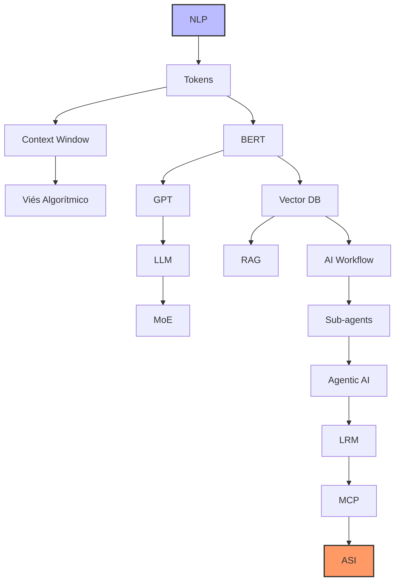

# Conceitos de IA

# 1. Resumo de conceitos

| Assunto | Surgimento (Aprox.) | Ordem de Estudo | Por que nesta ordem? |
| :--- | :--- | :--- | :--- |
| **NLP** | Anos 50/60 | **1** | A base teórica sobre como computadores processam linguagem humana. |
| **Tokens** | Anos 50/60 | **2** | A unidade fundamental. Sem entender tokens, você não entende custos nem limites. |
| **Viés Algorítmico** | Contínuo | **3** | Fundamental para entender as limitações e perigos dos dados desde o início. |
| **BERT** | 2018 | **4** | O marco inicial dos Transformers para compreensão de contexto bidirecional. |
| **GPT** | 2018 | **5** | O início da era generativa (foco em prever a próxima palavra). |
| **LLM** | 2020 | **6** | Quando os modelos ganharam escala e habilidades "emergentes". |
| **Context Window** | 2020 | **7** | Define quanto de informação o LLM consegue "manter na cabeça" por vez. |
| **MoE** | 2021 | **8** | Como modelos gigantes são eficientes usando apenas "partes" do cérebro. |
| **Vector Database** | 2021 | **9** | A infraestrutura necessária para dar memória de longo prazo aos modelos. |
| **RAG** | 2020/2023 | **10** | A técnica principal para conectar IAs a dados privados e atualizados. |
| **AI Workflow** | 2023 | **11** | Como estruturar processos que utilizam várias chamadas de IA em sequência. |
| **Agentic AI** | 2023/2024 | **12** | IAs que agem com autonomia para atingir um objetivo complexo. |
| **Sub-agents** | 2024 | **13** | A evolução da autonomia: agentes especializados gerenciados por um "chefe". |
| **LRM** | 2024 | **14** | Modelos que utilizam tempo de pensamento (Chain of Thought) para raciocínio lógico. |
| **MCP** | 2024 | **15** | O protocolo padrão mais recente para conectar agentes a qualquer base de dados. |
| **ASI** | Teórico | **16** | O horizonte final: quando a IA superar a inteligência humana em tudo. |

# 2. Planejamento de Estudos: Inteligência Artificial

## 2.1 Bloco A — Fundamentos Obrigatórios
*Sem estes, os demais temas ficam superficiais.*

1. **NLP (Natural Language Processing):** O campo da computação que estuda a interação entre máquinas e linguagem humana.
2. **Token:** A unidade básica de processamento dos modelos (pedaços de palavras ou caracteres).
3. **Context Window:** O limite de dados que o modelo consegue processar de uma só vez (sua "memória de curto prazo").
4. **Viés Algorítmico:** O estudo de como preconceitos nos dados de treino afetam os resultados da IA.

## 2.2. Bloco B — Modelos de Linguagem
*Entender como os modelos funcionam antes de usá-los como “caixa preta”.*

5. **BERT:** Modelo pioneiro do Google para entender o contexto bidirecional das frases.
6. **GPT:** Arquitetura focada em geração de texto (prever o próximo token).
7. **LLM (Large Language Model):** O conceito de modelos de linguagem em escala massiva.
8. **MoE (Mixture of Experts):** Técnica de arquitetura onde apenas "especialistas" internos do modelo são ativados, economizando processamento.

## 2.3.  Bloco C — Infraestrutura Semântica
*Essencial para aplicações reais, RAG e agentes.*

9. **Vector Database:** Bancos de dados que armazenam informações como coordenadas matemáticas (embeddings).
10. **RAG (Retrieval Augmented Generation):** Técnica que permite à IA consultar documentos externos antes de responder.

## 2.4.  Bloco D — Arquiteturas Modernas
*Aqui começa o “estado da arte”.*

11. **AI Workflow:** A estruturação de processos onde várias etapas de IA são encadeadas.
12. **Sub-agents:** Pequenas instâncias de IA especializadas em tarefas únicas.
13. **Agentic AI:** Sistemas com autonomia para planejar e executar ações para atingir um objetivo.
14. **LRM (Large Reasoning Model):** Modelos que "pensam" (Chain of Thought) antes de gerar a resposta final.
15. **MCP (Model Context Protocol):** O novo padrão para conectar modelos a fontes de dados e ferramentas de forma universal.

## 2.5.  Bloco E — Visão de Longo Prazo (Conceitual)
*Não é pré-requisito técnico, mas importante estrategicamente.*

16. **ASI (Artificial Super Intelligence):** O estágio hipotético em que a IA supera a inteligência humana em todos os domínios.

# 3. Diagrama

# 4. Conceitos por bloco

## 4.1. Bloco A — Fundamentos Obrigatórios

1. NLP (Natural Language Processing) É a subárea da Inteligência Artificial que combina linguística computacional e ciência de dados para permitir que softwares entendam, interpretem e gerem linguagem humana de forma natural. O objetivo do NLP é transpor a barreira entre a comunicação humana (que é ambígua, cheia de gírias e nuances) e o processamento de dados binários, sendo a base para tecnologias como tradutores automáticos, análise de sentimento e assistentes de voz.

2. Token Diferente dos humanos que leem palavras inteiras, os modelos de IA fragmentam o texto em unidades menores chamadas tokens, que podem ser palavras completas, sílabas ou até caracteres isolados. Esse processo de "tokenização" é crucial porque transforma a linguagem em sequências numéricas que a rede neural consegue processar matematicamente; em média, 1.000 tokens correspondem a cerca de 750 palavras em inglês.

3. Context Window (Janela de Contexto) Representa a capacidade máxima de dados (em tokens) que um modelo consegue "enxergar" e manter em sua memória de trabalho durante uma única interação. Se você fornecer um documento que exceda essa janela, a IA começará a "esquecer" o início do texto, perdendo a coesão. É o equivalente à quantidade de páginas que você consegue manter abertas na sua frente para realizar uma tarefa sem precisar fechar nenhuma.

4. Viés Algorítmico Ocorre quando um sistema de IA produz resultados sistematicamente distorcidos ou injustos, geralmente refletindo preconceitos históricos, sociais ou erros de amostragem presentes nos dados usados para treiná-lo. Como a IA aprende por padrões, se os dados de treino contiverem estereótipos de gênero, raça ou classe, o modelo irá replicar e até amplificar essas injustiças em suas previsões ou decisões automáticas.

## 4.2. Bloco B — Modelos de Linguagem

